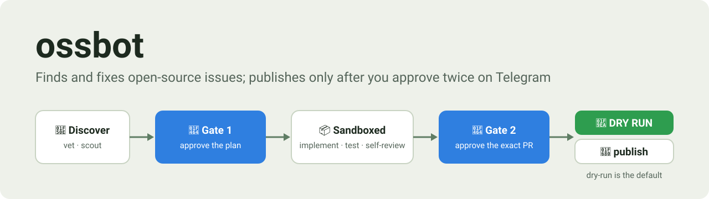
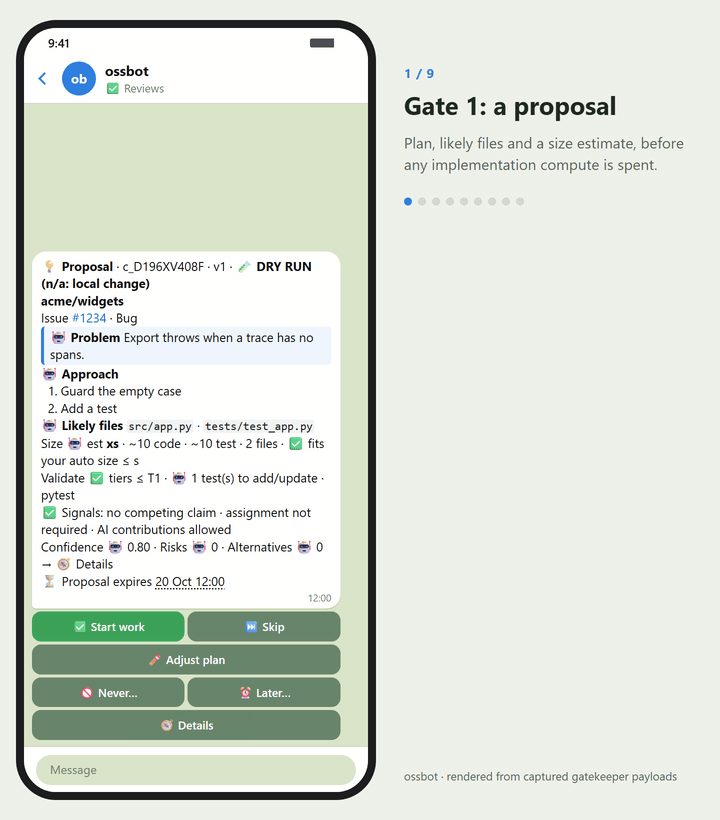
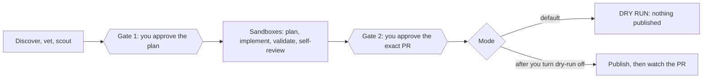
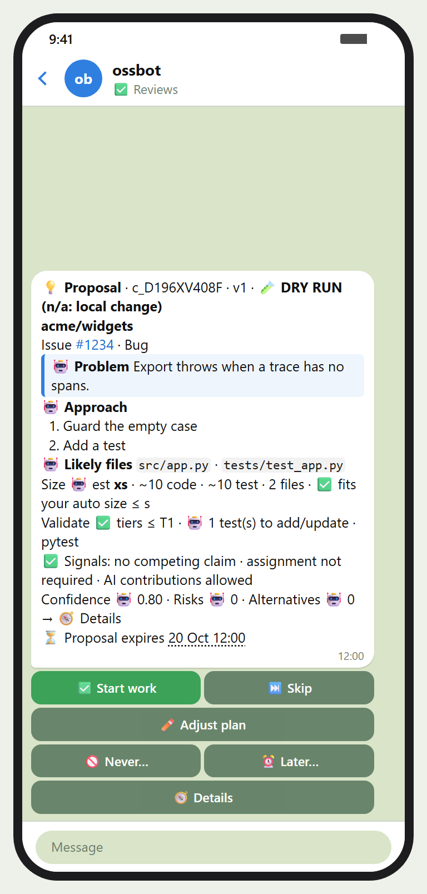
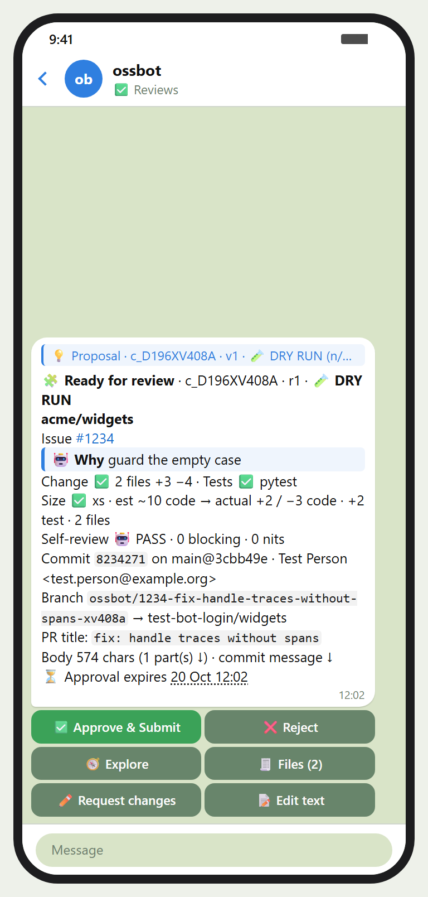
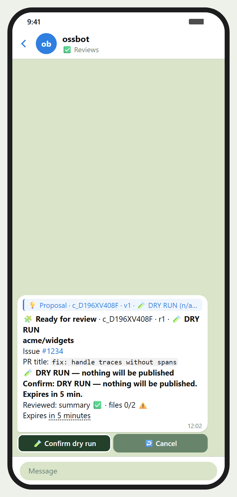
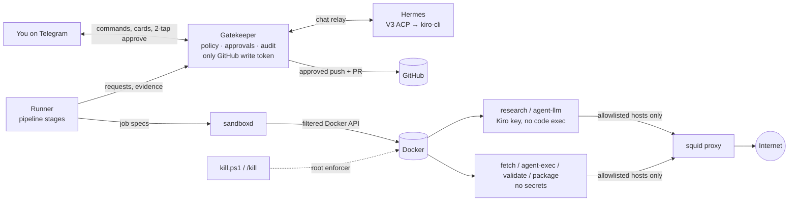

<p align="center">
  
</p>

<p align="center">
  <a href="LICENSE"></a>
  <a href="pyproject.toml"></a>
  <a href=".github/workflows/ci.yml"></a>
  <a href="#safety-model"></a>
</p>

**A self-hosted bot that turns open-source issues into pull requests, and asks you on Telegram before
it spends effort and before it publishes anything.**

<p align="center">
  
</p>

<p align="center"><sub>Every frame is rendered from the Telegram payloads the gatekeeper sent during the
hermetic end-to-end test (fictional repo <code>acme/widgets</code>, fake GitHub, test profile), not drawn by hand.
Also as <a href="docs/media/demo.mp4">MP4</a> and <a href="docs/media/stills/">PNG stills</a> (light and dark);
regenerate with <code>scripts/dev/make-demo.ps1</code>.</sub></p>

## Why

- **Contributing takes time you may not have.** ossbot finds issues worth fixing in the projects you
  pick, proposes a plan, implements and validates the change in throwaway sandboxes and prepares the PR.
- **You stay the author.** Nothing is public until you approve the exact content (a PR, a push to a PR,
  a comment or an issue claim), and the bot never approves anything itself.
- **It is yours.** It runs entirely inside one dedicated WSL distro on a Windows laptop, uses the Kiro
  CLI for every model call and has no inbound port, webhook or tunnel.
- **One bot for both.** The same Telegram bot is also a general multimodal assistant (Hermes), kept
  apart from the approval path.

The full specification is [`docs/DESIGN.md`](docs/DESIGN.md); the rebuild runbook is
[`docs/SETUP.md`](docs/SETUP.md).

## How it works



Pipeline: `discover → vet → scout → PROPOSAL (gate 1) → fetch → plan → implement → validate →
self-review → PREVIEW (gate 2) → submit → watch`.

### What you approve

<table>
  <tr>
    <td align="center" width="33%"></td>
    <td align="center" width="33%"></td>
    <td align="center" width="33%"></td>
  </tr>
  <tr>
    <td align="center"><b>1. The plan</b><br>Start work, then Confirm: the bot may now spend compute.</td>
    <td align="center"><b>2. The exact PR</b><br>Built by the gatekeeper from the commit it would push.</td>
    <td align="center"><b>3. The mode</b><br>The confirm button says DRY RUN or LIVE.</td>
  </tr>
</table>

### Architecture



Component details: [`docs/ARCHITECTURE.md`](docs/ARCHITECTURE.md).

## Safety model

- **One deterministic gatekeeper holds the only GitHub write token.** It runs no LLM, executes no repo
  code and checks out no untrusted tree. Only `gatekeeper/submit.py` can reach the GitHub writer
  (import-linter contract).
- **Two human gates, both two-tap and bound to exact content and mode.** Gate 1 approves a scouted
  proposal (plan plus size estimate) before any implementation compute is spent. Gate 2 approves the
  public action itself, against a gatekeeper-derived preview. Approvals are never LLM-mediated and have
  no API endpoint.
- **Dry-run is ON by default.** A dry run records the "would push" payload and writes nothing to GitHub.
  Every dry-run toggle invalidates open approvals.
- **The kill switch is checked at every stage, job and outbound action** and survives reboots
  (`/kill`, `ossctl kill`, `scripts\kill.ps1`).
- **Repo code runs only in credential-free sandboxes** with a hostname egress allowlist; the container
  that holds the Kiro key never runs repo code (split coder).
- **A hard size ceiling** (`config/policy.yaml` `diff.max_files: 80`, `max_changed_lines: 3000`,
  `max_test_lines: 3000`) refuses runaway diffs. It cannot be raised from Telegram.
- **No exposure.** No webhook, tunnel, Mini App or inbound port; Telegram uses long polling.

## Quickstart

Prerequisites: Windows 11 with WSL 3.x (`wsl --install --no-distribution`), admin rights once,
about 150 GB free on `D:`, a Telegram account, a GitHub account and a Kiro subscription with API keys.

```powershell
git clone https://github.com/<owner>/autonomous-oss-contributor.git D:\Work\autonomous-oss-contributor
cd D:\Work\autonomous-oss-contributor
powershell -NoProfile -File scripts\install-hooks.ps1      # gitleaks + personal-value pre-commit hook
copy config\profile.example.yaml config\profile.yaml        # then edit: your login, email, Telegram id
powershell -NoProfile -File scripts\bootstrap.ps1           # creates and provisions the ossbot distro
powershell -NoProfile -File scripts\setup-secrets.ps1       # bot token, Kiro keys, GitHub tokens
powershell -NoProfile -File scripts\ossctl.ps1 doctor       # until everything is PASS
```

Then send `/status` to your bot, run a first discovery (`ossctl discover --repo <owner/repo>`), review
the proposal and preview cards and approve them in DRY RUN. The repo path is fixed in v1. Everything
else, including restore from a backup, is in [`docs/SETUP.md`](docs/SETUP.md).

## Daily use

- **Up and down with the laptop.** ossbot starts with Windows (`ossbot-autostart`) and shuts down
  gracefully on Windows shutdown or restart (a per-user shutdown blocker that drains ossbot through a
  channel into the distro it opened at logon).
  By hand: `scripts\up.ps1`, `scripts\down.ps1`, `scripts\status.ps1`, or `ossctl up|down|status`
  in the distro, or `/up`, `/down`, `/drain`, `/undrain` on Telegram. `down` drains running work
  (default 120 s), re-queues the rest and sends a summary; it never invalidates approvals.
- **Lifecycle is not kill.** `/pause` stops new stages; `/kill` (or `scripts\kill.ps1`) stops
  everything and survives a reboot; only `/resume` (or `scripts\resume.ps1`) undoes them.
- **Reviewing.** Proposal cards arrive in ✅ Reviews. Tap Start work (gate 1) to let the bot implement;
  the preview card follows with the diff explorer, per-file diffs, line comments and the code/test
  line split. Approve, then Confirm (gate 2). Mode is always labelled DRY RUN or LIVE.
- **Backups.** `scripts\backup.ps1` (or `ossctl backup now`) writes an age-encrypted archive to
  `backups\`; `ossctl backup schedule on` enables the weekly timer.
- **Upgrades.** `ossctl kiro upgrade`, `ossctl hermes upgrade` after bumping `config/versions.lock.yaml`.
- **Logs.** `scripts\ossctl.ps1 logs <gatekeeper|hermes|runner|sandboxd> [-Since 15m] [-Grep <regex>]`
  reads one service's journal from Windows (read-only; `|` in the regex is safe).

## Housekeeping

Retention is time-based, with no size caps:

| What | Kept for |
|---|---|
| systemd journal | 30 days (journald drop-in) |
| Docker build cache | records unused for 7 days, pruned weekly; dangling images outside the pinned set, daily |
| `/tmp` leftovers | 7 days |
| Mirrors, bundles, imports and artifacts of finished contributions; unused cache repos | 30 days after they finished |
| Closed Telegram rows (outbox, views, button tokens) | 90 days |
| Sandbox run logs | 30 days |
| Idle files in Hermes' `sessions/` dir | 90 days (the sessions themselves live in Hermes' `state.db` and stay resumable) |

Never selected: the audit log, open contributions and anything awaiting approval.
`ossbot-gc.timer` runs daily and `ossbot-docker-prune.timer` weekly; both skip while ossbot is killed
or paused. See what would go with `sudo ossctl gc --dry-run` in the distro. `fstrim` runs after each
pass, so the sparse `ext4.vhdx` gives the freed space back to Windows. Change the periods in
`config/policy.yaml` `retention:`, then `/reload`. Details: [`docs/SETUP.md`](docs/SETUP.md#housekeeping).

## Telegram tour

With **Threaded mode** on in @BotFather (recommended, see SETUP.md), the bot creates four system threads
(forum topics in the Bot API): 🚦 **Control** (pinned live dashboard, lifecycle and kill), ✅ **Reviews**
(proposal, preview, skill and model cards), 📈 **OSS feed** (status updates, the PR status card, the
digest) and 💬 **Assistant** (Hermes). Every other thread you create is a separate Hermes conversation.
With Threaded mode off, everything works in one chat with section headers. `/status` answers with the
same card as the pinned dashboard, in the thread you asked from. The Bot API cannot pin into a thread:
the pin belongs to the message, so the dashboard is sent into Control and pinned there; some clients
also list that pin in the "All" view, and tapping it jumps to Control. Known gap: `/status` sent in the
"All" view creates a new empty thread named "/status" and the card lands in All; ask in 🚦 Control
instead until it is fixed.

Every non-command message (text, photos and albums, documents, voice notes, locations, replies) goes
to Hermes, which streams answers with sources and a ⏹ Stop button. Hermes can never approve, resume,
reload config or turn dry-run off. Notifications have priorities (P0 always loud), quiet hours,
batching and a daily digest; `/quiet` and `/notify` tune them.

Safety classes: `go` and `config` commands (resume, dry-run off, reload, egress, tier, model) always
need a confirm tap; `stop` commands (pause, kill, drain, down) run at once; `read`, `personal`, `tune`
and `request` never touch an approval or the ceiling. The command table below is generated from the command registry by
`ossctl docs commands` (CI checks it is current):

<!-- BEGIN ossctl docs commands (generated; edit the registry, then run `ossctl docs commands`) -->
| Command | What it does | Safety class |
|---|---|---|
| `/approve` | Re-send a contribution's card (never approves by itself) | read |
| `/articles` | Published Telegraph articles, with Unpublish | personal |
| `/budget` | Alias of /limits | read |
| `/dashboard` | Re-send and pin the live dashboard | read |
| `/digest` | Daily and weekly digest: send now, on/off, times | personal |
| `/down` | Down (workers): stop the workers, keep the gatekeeper up | stop |
| `/drain` | Drain: no new work, running work may finish (immediate) | stop |
| `/dryrun` | /dryrun on (immediate) or /dryrun off (asks for confirmation) | go |
| `/egress` | Egress mode allowlist / research / open (asks for confirmation) | config |
| `/filters` | Autonomous discovery filters (4 pages; /work ignores them) | tune |
| `/help` | List commands | read |
| `/hermes` | Hermes capability tier: /hermes tier (asks for confirmation) | config |
| `/kill` | Soft kill: stop all work and outbound actions (immediate) | stop |
| `/limits` | Usage vs limits | read |
| `/logs` | Stage logs: /logs [cid] [stage] | read |
| `/memory` | What Hermes remembers | read |
| `/model` | Switch the model of a role (asks for confirmation) | config |
| `/new` | Start a new Hermes conversation | personal |
| `/newchat` | Alias of /new | personal |
| `/notify` | Notification toggles per category (mute or batch, never drop) | personal |
| `/pause` | Pause the pipeline (immediate) | stop |
| `/queue` | What waits for you, gate 2 first, with Open buttons | read |
| `/quiet` | Quiet mode: P1 silent, P2 held (P0 still rings) | personal |
| `/reject` | Reject an open card: /reject [cid] [reason] | config |
| `/reload` | Reload the config files: see the changes, then confirm | go |
| `/remind` | List, add or cancel reminders | personal |
| `/repos` | Target repos: enable, allow AI, per-repo size | read |
| `/resume` | Resume after pause or kill (asks for confirmation) | go |
| `/review` | Explore an open card's changes: /review [cid] | read |
| `/settings` | Rich views, notifications, quiet hours, digest | personal |
| `/size` | Autonomous size preference (xs…xl; /work ignores it) | tune |
| `/skills` | Staged and active Hermes skills | read |
| `/start` | What ossbot is and where things are | read |
| `/status` | The dashboard card (state, dry-run, work, approvals, config and audit heads) | read |
| `/title` | Rename this chat thread (Threaded mode) | personal |
| `/undrain` | Stop draining and schedule work again (asks for confirmation) | go |
| `/up` | Start the workers again (asks for confirmation) | go |
| `/work` | Work on a GitHub issue, PR or repo you choose (👤; filters don't apply) | request |
<!-- END ossctl docs commands -->

## Egress modes and Hermes capability tiers

One switch, the **egress mode**, decides how much of the public web LLM components get. It never
changes what untrusted code can reach: `fetch` and `validate` sandboxes keep their package and GitHub
allowlists in every mode, and gatekeeper and runner egress is identical in every mode.

| Mode | Research jobs and Hermes | Coder (`agent-llm`) |
|---|---|---|
| `allowlist` | named categories only, no general web | Kiro endpoints only |
| `research` | plus the public web | Kiro endpoints only |
| `open` (default) | plus the public web | plus the public web (web search for unknowns) |

Switch with `/egress <mode>` or `ossctl egress mode <mode>` (confirm required, audited). An unreadable
mode flag falls back to `allowlist`.

The **Hermes capability tier** decides which Hermes toolsets are on:

| Tier | Adds |
|---|---|
| `locked` | memory, todo, session search, the `ossbot` plugin tools |
| `research` | plus proxy-routed web tools and the read-only GitHub MCP server |
| `self_improve` (default) | plus skills, each activated only after its own two-tap skill card |

Switch with `/hermes tier <tier>` or `ossctl hermes tier <tier>`. In every tier `terminal`,
`code_execution`, `file`, `browser`, `delegation` and `cronjob` stay disabled; when Hermes needs code
run it asks for a network-less sandbox job. An unreadable tier flag falls back to `locked`. Any tool
outside the active tier's allowlist soft-kills the chat relay.

## Models

All model choices live in `config/models.yaml` (the global model switch, DESIGN §16). Nothing else
in the repository names a model id, and a unit test enforces this.

- `default` and the pipeline roles: claude-opus-5.5 where deep reasoning is needed (planner, scout,
  coder), claude-sonnet-5.5 elsewhere (vetter, reviewer, summarizer, chat, vision). The reviewer
  must use a different model from the coder. If no distinct model is available, the pipeline
  pauses instead of reviewing with the coder's model.
- `test`: the model of every live check that sends a prompt (`ossctl kiro smoke`, the doctor's live
  checks, the safety probes, live round-trips and tests). It uses the cheapest catalog model and
  `fallback: none`, so a missing test model is a clear error, never a silent switch to an expensive
  model. `test_vision` inherits `test` for the live image check and can be pointed at an
  image-capable model on its own.
- Each role may set `fallback: none`, an explicit list of ids, or nothing (inherit, else the global
  `fallbacks`).

Switch a production role with `ossctl model set <role> <catalog id> [--effort e]` or the Telegram
`/model` picker. `test` and `test_vision` change only in `config/models.yaml` or with
`ossctl model set test <catalog id>`; the `/model` picker never offers them. Every change is
validated against the Kiro catalog, audited and announced on Telegram. `ossctl model list` shows
what each role resolves to.

## How the bot picks work

Autonomous discovery ranks open issues on the enabled targets (`config/targets.yaml`) by size fit,
maintainer responsiveness, outside-contributor merge rate, labels that invite help, issue freshness and
clarity, your interest categories and your history in that repo. The top few per cycle become proposal
cards (at most five a day).

Size is a **preference** for what the bot picks on its own. Classes count non-test changed lines,
excluding lockfiles, generated and vendored files: `xs` ≤ 20, `s` ≤ 80, `m` ≤ 250, `l` ≤ 500,
`xl` ≤ 1000, `xxl` above. The default autonomous maximum is `s`; change it with `/size`,
`/repos <repo> size <class>` or `ossctl size set`, and narrow the kinds of work with `/filters`. These
never touch an approved proposal, a user-directed item, a gate or the ceiling.

The **hard ceiling** (80 files, 3000 code lines, 3000 test lines) is a runaway-agent guard, not a
preference. It applies to everything, including your own requests, and changes only by editing
`config/policy.yaml` plus a confirmed `/reload`.

**User-directed work.** `/work <issue, PR or repo URL> [notes]`, a forwarded GitHub link with
`🛠 Work on this`, or `ossctl work <url>` creates a contribution marked `👤 requested by you`. It skips
ranking, caps, the size preference and the filters, may be any size, and still passes both gates, the
forbidden paths, the repo's AI policy, a CLA check, the one-open-PR-per-repo rule and the ceiling.

Tests are expected: when the repo has a suite, the coder adds or updates tests for the change, and the
preview card shows code and test lines separately.

## Repository layout

| Path | What it holds |
|---|---|
| `src/ossbot/gatekeeper/` | the trusted service: approvals, policy, audit, state machine, Telegram front-end, GitHub writer |
| `src/ossbot/runner/` | pipeline stages (discover … watch); talks only to the gatekeeper and sandboxd |
| `src/ossbot/sandboxd/` | sandbox job daemon: profiles, Kiro settings, safety probes, output key scan |
| `src/ossbot/dockerfilter/` | root Docker API filter (allowlisted creates only) |
| `src/ossbot/sandbox_tools/` | stdlib-only tools copied into the sandbox images |
| `src/ossbot/ctl/` | `ossctl`: operator CLI, doctor, backup/restore, lints |
| `src/ossbot/watchdog/` | health, drift and anomaly checks |
| `src/ossbot/common/` | config schemas, control flags, snapshot, shared helpers |
| `hermes/` | Hermes plugin and config templates |
| `vendor/hermes-kiro-provider/` | the vendored V3 ACP provider fork |
| `sandbox/` | sandbox and proxy image definitions |
| `systemd/` | service, timer and path units |
| `scripts/` | Windows entry points (`bootstrap.ps1`, `up.ps1`, `kill.ps1`, …) and `provision.sh` |
| `config/` | policy, targets, egress, models, Telegram config, `versions.lock.yaml`, the profile template |
| `prompts/`, `.kiro/` | role prompts, Kiro agents, steering |
| `tests/` | unit, telegram, acp, e2e, sandbox, system and isolation suites |
| `docs/` | design, plan, ADRs, setup, architecture, verification |

## CI

`.github/workflows/ci.yml` is manual: Actions → ci → Run workflow. It runs the lint gate (ruff,
mypy, import-linter, shellcheck, PSScriptAnalyzer), the hermetic suites
(`pytest -m "unit or telegram or acp or e2e"`), gitleaks over the full history, the README command
table check and the profile example check, with `contents: read`, SHA-pinned actions and no secrets.
The sandbox, Docker and system suites need the provisioned distro and run only on the laptop.

## Status and limitations

v1 is feature-complete for a single owner on one Windows laptop and still runs in dry-run until the
owner turns it live. Not in v1: stack validation (compose/kind, behind a flag), proactive discovery,
the Android sandbox image, the Telegram Mini App and the §14.19 integrations listed as deferred in
`docs/PLAN.md`. It runs only on Windows with WSL; processes of the Windows user are out of scope of
the isolation model.

Assistant features ship as Hermes skills or `ossbot` plugin tools with their own feature cards
(`src/ossbot/gatekeeper/features/`, enabled in `config/telegram.yaml` `features.enabled`). Feature
list: v1 ships the registry and no feature yet; each new feature adds one line here (AGENTS.md,
"Add a Telegram feature").

## AI disclosure

This repository is developed with AI assistance (Kiro); every change is reviewed by a human
maintainer. Contributions it prepares carry an AI disclosure.

## Contributing

See [CONTRIBUTING.md](CONTRIBUTING.md) (dev setup, tests, DCO sign-off, AI-assisted contributions,
adding a model backend), the [Code of Conduct](CODE_OF_CONDUCT.md) and [SECURITY.md](SECURITY.md) for
private vulnerability reports. The invariants every change must keep are in [AGENTS.md](AGENTS.md).

## License

Licensed under the [Apache License 2.0](LICENSE). Anyone may use, modify and redistribute it. Under
section 4(d), a redistribution (including a modified version) must keep the attribution in
[NOTICE](NOTICE), which credits the author. Third-party components and their licenses are listed in
[THIRD_PARTY_NOTICES.md](THIRD_PARTY_NOTICES.md); the vendored `vendor/hermes-kiro-provider` keeps its
MIT license.
