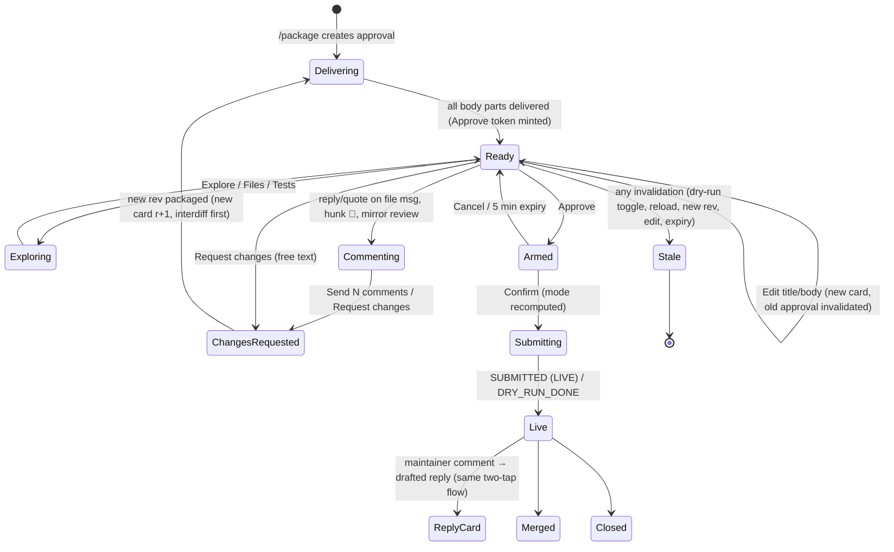

# ADR-0019: PR review surface: native Telegram explorer by default, private GitHub review mirror as the opt-in rich layer
Status: Proposed (CR-003) · Date: 2026-10-18 · Design: CR-003 §5, DESIGN §14.3–§14.4a · Related: ADR-0004, ADR-0014

## Context
Amsal reviews almost every candidate on his phone. Today's review surface (DESIGN §14.4) is one card, the verbatim PR body and commit message in `<pre>` parts, a diff paged through `editMessageText`, and a `.patch` file. It is safe, but on a phone it is flat. It has no per-file navigation, no way to comment on a line, and no "what changed since my last review".

Hard constraints that any surface must keep:
- ADR-0004: one bot, polled by the deterministic gatekeeper with long polling (python-telegram-bot 22.8). There is no webhook, no inbound port and no static IP.
- Approve, submit, resume, dry-run off and skill activation stay deterministic gatekeeper actions. Each is two taps (Approve, then Confirm) on single-use, expiring tokens. A token is bound to its message and accepted only from the allowlisted user in the private chat. No LLM is in that path.
- ADR-0014: an approval binds the gatekeeper-derived patch, the head SHA and the title/body hashes. Any edit invalidates it.
- Nothing public happens before approval. Dry-run is on by default and always labelled.

### Research (October 2026; sources in CR-003 §19)
- Bot API 10.1–10.3 added **rich messages**: `sendRichMessage`, `sendRichMessageDraft`, and `editMessageText(rich_message=…)`. A rich message holds up to 32,768 characters and 500 blocks. Blocks include headings, tables, collapsible `details`, expandable quotes, `pre` with a language, in-document anchors and in-body buttons. A message can be built from typed **blocks** with no markup parsing at all.
- Bot API 10.3 added disabled buttons and `force_reply` on inline keyboards. Bot API 9.4 added button styles (`success`, `danger`, `primary`). Bot API 9.3 and 9.4 added topics in private chats. Bot API 9.5 added the `date_time` entity (`<tg-time>`), which the client renders in local time or as relative time.
- A user's reply can carry a `quote` (`TextQuote`: the selected text plus its UTF-16 position). That anchors a comment to the exact lines the user selected.
- Mini Apps can be validated without the bot token, using the Ed25519 `signature` field and Telegram's published public key. They also offer `DeviceStorage` (5 MB per user), `SecureStorage` (Keychain/Keystore, 10 items), Main and Secondary buttons, fullscreen mode and theme parameters. Since 2026-07-20, Mini App methods can't be called from foreign origins.
- **Telegram Serverless** (2026-10-06) hosts JavaScript handlers, endpoints, a SQLite database and Mini App files at `app<id>.tgcloud.ai`. BotFather manages a **webhook** for the bot, and the Bot API refuses `getUpdates` while a webhook is set. Turning Serverless on for the ossbot bot would therefore break ADR-0004.
- python-telegram-bot 22.8 (2026-06-12) fully supports Bot API 10.0. The 10.1–10.3 features need raw calls through `Bot.do_api_request`, which the outbox already uses for every send.
- Prior art: `SanNw/opencode-telegram` routes only an authenticated "Bridge" through an HTTPS tunnel and keeps the OpenCode server on loopback. Access is protected by Telegram-signed init data, an owner check and a trusted-device key. HTML previews are static and sandboxed. Even that design adds an internet-reachable component. ossbot does not need one by default.

## Options

**A. Native Telegram.**
- The decorated card stays a classic HTML message (the bound approval surface).
- An explorer message walks the sections. Each file opens as its own message with syntax-highlighted hunks: a rich message when available, classic `<pre><code class="language-diff">` pages otherwise.
- Long sections sit in expandable blockquotes or `details` blocks. Test-log excerpts are included.
- Two documents are attached: a full `.patch` and a self-contained, script-free HTML diff.
- To comment, the user replies to a file message, optionally quoting lines, or taps 💬 and picks a hunk. Comments collect into a draft review that is sent as one change request.
- A revised candidate shows a gatekeeper-computed interdiff.

**B. Telegram Mini App diff viewer.** A web app with a split or unified diff, a file tree, logs and inline comments. Approve stays a chat button. It needs a way to get data into the app without a static IP:
- **B1 static app on GitHub Pages with end-to-end encrypted data.** The app code would be public, and GitHub Free serves Pages only from public repositories. The ciphertext has no carrier. A URL fragment holds only a few KB. Telegram files can't be fetched without the bot token. A secret gist needs a new gist-write credential and is readable by URL. In practice B1 does not work for real diffs.
- **B2 Telegram Serverless.** The platform webhook conflicts with long polling, so B2 needs a second bot. It also needs a Node toolchain, a separate CLI token, and a way to move bundles from the gatekeeper into the serverless database: bot-to-bot messages to that second bot. Pre-approval diffs would sit in Telegram's serverless database, in plaintext unless also end-to-end encrypted.
- **B3 optional tunnel to a read-only local review server.** Tailscale Funnel gives a stable `*.ts.net` name, and TLS ends on the device, so Tailscale can't read the content. A Cloudflare named tunnel needs a domain, and TLS ends at Cloudflare. Cloudflare quick tunnels are for testing only and do not support SSE. The server would verify the Ed25519 init-data signature, so it holds no bot token. It would hold no secrets and serve only derived artifacts. Comments go back through `Telegram.WebApp.sendData` as an ordinary chat update, so the server stays read-only. This is the cleanest B, but it is a new internet-reachable path plus a web front-end to build and maintain.

**C. Private GitHub review mirror.**
- The gatekeeper pushes a display copy of the candidate to a private repo owned by Amsal1 (e.g. `Amsal1/ossbot-review`) and opens a PR there.
- Amsal reviews in the GitHub mobile app, with its diff UI, file tree, inline comments and suggestions.
- The gatekeeper polls the mirror PR and turns his review into a change request. It is a write to GitHub, but not a public one. It uses a separate fine-grained token scoped to that one private repo.

**D. Telegraph article (Instant View)** for the review text (user suggestion, 2026-10-18). This is evaluated and **rejected for review content**:
- Telegraph pages are public to anyone with the URL.
- The API can't delete a page; blanking it is the only option.
- Content is capped at 64 KB.
- Only basic tags are allowed: no syntax highlighting, no tables, no collapsible blocks.

Pre-approval diffs, vetting and maintainer notes, and unreleased changes would become public and permanent before any approval, which violates "nothing public before approval". CR-003 §6.8 allows Telegraph only for opt-in, scanned assistant answers.

**Combinations.** A+C, A+B3, A+C+B3.

### Evaluation

| | A native | B1 Pages + E2E | B2 Serverless | B3 tunnel Mini App | C private mirror |
|---|---|---|---|---|---|
| Phone UX | Good with rich messages (file per message, highlighted hunks, collapsible sections); fair on classic fallback | Excellent if it worked | Excellent | Excellent | Excellent (GitHub mobile diff, tree, expand context, suggestions, rendered Markdown) |
| Inline comments | Yes: reply or quote on file messages, hunk picker | Needs a write path | Yes (endpoint) | Yes, via `sendData` through the chat | Yes, native review comments and suggestions |
| New exposure | None | Public app code; a third-party store for ciphertext | Second bot, JS runtime on Telegram, CLI token | **Internet-reachable server** via tunnel; tunnel daemon and egress | New write token, scoped to one private repo; no inbound |
| Data leaving the laptop, and to whom | Telegram (cloud chats use server-client encryption, like today's cards) | GitHub Pages (app), gist host (ciphertext) | Telegram Serverless DB | Tunnel provider (Funnel: metadata only; Cloudflare: plaintext); Telegram | GitHub (Microsoft), private repo: the touched files at base and head, title/body, commit message, validation summary |
| User setup | None | Pages repo, BotFather URL | BotFather Serverless, second bot, Node | Tailscale/Cloudflare account, BotFather URL | Create a private repo, disable Actions, one fine-grained token |
| Build effort | Medium | High, and blocked on the carrier | High (new stack) | High (web app, server, tunnel provisioning, uid, doctor) | Medium (plumbing trees, push, PR, poll, map comments) |
| Failure modes | Rich rendering differs between client versions (classic fallback); Telegram outage | Carrier limits | Webhook conflict; vendor lock-in; platform is new | Tunnel down, DNS lag, WebView quirks, exposed attack surface | GitHub outage, push protection blocking a test secret, token expiry, repo made public |
| Can it approve? | Only through the chat card (unchanged) | Never | Never | Never | **Never**: GitHub review states are ignored for approval |

## Decision
1. **A is the default and is always on.** It works with zero extra setup. The approval card and the Confirm step stay classic HTML messages whose reply-markup tokens are bound to the card's message ID (CR-003 U3). Rich messages are used only for read-only views: explorer, files, interdiff, tests and assistant answers. They are built in **blocks mode** with plain strings and `skip_entity_detection`, so no untrusted byte is ever parsed as markup. On a client or API failure the gatekeeper falls back to the existing classic renderer automatically.
2. **C is the opt-in rich layer.** `review_mirror.enabled: false` by default. Enabling it requires the mirror repo, its token, a passing `ossctl review-mirror enable` doctor probe and a human-confirmed `/reload`. When it is on, the card gains a URL button `🐙 Review on GitHub`, and mirror review comments become draft-review comments in Telegram (CR-003 §5.14). C beats B as the rich layer for three reasons: GitHub mobile already is a first-class diff reviewer, C adds no inbound path, and there is no web UI to maintain.
3. **B is deferred to phase 2.** If it is ever built, it is B3 and must stay optional, off by default and read-only. It must verify init data with Ed25519 (no bot token on the server), hold no secrets and never approve. Comments travel through `sendData` as chat updates. **Serverless is rejected for this bot** while ADR-0004's long polling stands. B1 is rejected because there is no data carrier. **D (Telegraph) is rejected for every kind of review content**, because its pages are public and can't be deleted.
4. **The approval binding is unchanged.** Every display artifact is derived from `derived/<cid>/<rev>/` and is never bound or trusted: rich views, interdiff, HTML diff and the mirror commits. Display artifacts include the mirror commits, whose SHAs differ from the real ones. The binding stays `patch_sha256`, `head_sha` and the title/body hashes (ADR-0014).

## Review flow (states and screens)
Field-level content, keyboards and limits are in CR-003 §5. Mockups are in `docs/ux/`.

| Screen | State | What the user sees | Mockup |
|---|---|---|---|
| S1 Preview card | Delivering → Ready | Header with mode badge, subject, verified checks, model claims marked 🤖, change stats, expiry as relative `tg-time`; body and commit message parts below; keyboard minted only after delivery | `01-pr-preview-card.svg` |
| S2 Explorer | Exploring | One message, sent as a reply to the card and edited in place: 1 Summary → 2 Why this issue → 3 Signals → 4 Risk → 5 Files → 6 Diff → 7 Tests → 8 Self-review → 9 PR text | `02-diff-explorer.svg` |
| S3 File view | Exploring | One message per file: hunks highlighted as `diff`; collapsible long hunks; ◀ Files ▶; 💬 Comment; `.patch`/HTML documents | `02-diff-explorer.svg` |
| S4 Draft review | Commenting | Each comment acknowledged (file:line, Undo); one draft-review message: "📝 3 comments · Send · Discard" | `02-diff-explorer.svg` |
| S5 Changes in progress | ChangesRequested | Old card stubbed "✏️ Changes requested → r3 in progress"; stage progress edited in place | `04-interdiff.svg` |
| S6 Revised card | Delivering/Ready (r+1) | New card, sent as a reply to the old one: what you asked for → interdiff (gatekeeper) → "coder says" per comment (🤖) → "touched in interdiff" flag per comment (gatekeeper) | `04-interdiff.svg` |
| S7 Edit text | Ready | Picker: Title / Body / Body as file / Clear my edits; ForceReply; new card, old one stale | `01-pr-preview-card.svg` (notes) |
| S8 Confirm | Armed | Card edited to the Confirm panel: 🧪 DRY RUN or 🔴 LIVE banner, exact Confirm sentence, review coverage, unsent-comment warning, 5-minute relative expiry | `03-approve-confirm.svg` |
| S9 Submitting | Submitting | Progress lines: fork, push, PR | `05-submitted-status.svg` |
| S10 Live status | Live | A status card edited in place (CI, reviews, maintainer comments); P1 events arrive as replies; drafted replies use S1/S8 | `05-submitted-status.svg` |
| S11 Merged/closed | Merged/Closed | Status card finalized; summary message (with a message effect when configured) | `05-submitted-status.svg` |
| S12 Stale | Stale | Card header "⚪ Superseded/Expired/Invalidated: <reason>", disabled button "⛔ Not approvable", "⬇️ Show current" | `04-interdiff.svg` |

Queue and priority (CR-003 §5.13): pending approvals sort by `(class_rank, expires_at, -target_priority, created_at)`. Classes, highest first:
1. Someone is waiting: a reply to a maintainer, or a `push_update` a maintainer asked for.
2. `issue_claim`.
3. Other `push_update`.
4. `open_pr`.
5. Other comments.

At most `telegram.loud_cards_per_hour` (default 2) new cards notify with sound; the rest are sent silently and counted on the dashboard.

## Option C, normative details
- **Repo:** `profile.yaml review_mirror.repo` (e.g. `Amsal1/ossbot-review`). The user creates it, with a README on `main`.
  - Before every push, and every 10 minutes while it is enabled, the gatekeeper checks `GET /repos/<mirror>`: `private == true` and `visibility == "private"`. It also checks `GET /repos/<mirror>/actions/permissions`: `enabled == false`.
  - Either check failing disables the mirror and raises an alert. A repo that is public is a P0 alert.
  - Actions must be off because the mirrored tree contains upstream workflow files, and a PR would run them.
- **Token:** `GITHUB_REVIEW_MIRROR_TOKEN` in `gatekeeper.env` (0600 gatekeeper).
  - Fine-grained, resource owner Amsal1, "Only select repositories" = the mirror.
  - Permissions: Contents RW, Pull requests RW, Metadata R, and Administration R (only to read the Actions setting; **[VERIFY]** the minimum permission).
  - GitHub documents that only classic tokens can write to public repositories the user does not own, and the repository selection excludes his own public forks.
  - The existing classic `public_repo` token cannot reach private repos, so the two tokens can't be swapped by accident.
- **Probe at enable time** (`ossctl review-mirror enable`, human-initiated only, never during automated builds):
  - `GET /user` must return `login == profile.github_login`.
  - A foreign-write probe on one of Amsal1's public repos: `POST /repos/<public repo>/git/refs` with an all-zero SHA and a random `refs/heads/ossbot-probe-*` name. It cannot create anything. 403 or 404 passes. 422 means the token can write there, so enable is refused and a P0 alert says to revoke the token.
  - `GET /repos/<mirror>` with the classic write token must return 404.
  - The token's `github-authentication-token-expiration` header is recorded. A P1 reminder goes out 14 days before expiry.
- **Sparse snapshot commits (display only):**
  - Built in the per-rev bare mirror with the hardened `GIT_ENV`/`GIT_ARGS` and a temporary `GIT_INDEX_FILE` under `/srv/ossbot/gatekeeper/work/`, using plumbing only (`read-tree --empty`, `ls-tree -z`, `update-index --cacheinfo|--force-remove`, `hash-object -w --stdin`, `write-tree`, `commit-tree`).
  - `B'` holds the base versions of exactly the touched paths.
  - `H'` holds the head versions, plus `.ossbot-review/{PR_BODY.md,COMMIT_MSG.txt,REVIEW.md}` built by the gatekeeper.
  - Commit messages and PR text never contain `@`, `#N` or bare URLs: upstream links appear only inside code spans, so no cross-references or notifications are created.
  - Fixed identity: `ossbot review mirror <noreply@invalid>`, with the package timestamp as the date.
  - **Integrity check before push:** `diff --raw B' H'` outside `.ossbot-review/` must equal `diff --raw <base> <head>` (paths, modes, blob IDs). A mismatch means no push and an ERROR log. A candidate that touches `.ossbot-review/` is refused for mirroring.
  - Pushes are small: only the touched files.
- **Push and PR:**
  - `review_mirror_writer.py` is the only module allowed to write. It is importable only by `review_mirror.py`, enforced by an import-linter contract. It hard-refuses any URL or API path outside `/repos/<mirror>/` and `https://github.com/<mirror>.git`.
  - It force-pushes `H':refs/heads/review/<cid>` and `B':refs/heads/review-base/<cid>`. Force is allowed **only** here; the main writer still never force-pushes.
  - It opens or updates the PR: head `review/<cid>`, base `review-base/<cid>`, title `[<cid> r<rev>] <title>`, and a body with the card facts and instructions.
  - A new rev force-pushes over the old one. GitHub then shows "force-pushed" with a compare link, which is a second interdiff for free.
- **Reading back:**
  - Polling: every 60 s while the approval is pending, every 10 min otherwise, with ETags. It reads `pulls/<n>/reviews`, `pulls/<n>/comments` and `issues/<n>/comments`.
  - Only comments by `profile.github_login` count. Each comment's `path` must be in this rev's numstat. A comment whose `commit_id` is not the current `H'` is flagged outdated.
  - A submitted review (Comment or Request changes) becomes **one** change request with all its comments and suggestions, verbatim. A Telegram note goes out ("🐙 GitHub review: 3 comments → change request r3").
  - Single comments outside a review join the Telegram draft review.
  - An **Approve** review is ignored for approval. Telegram replies: "Approvals only count here", with `⬇️ Show card`.
  - A commit the user makes on the mirror branch, such as "edit file" in GitHub mobile, becomes a change request carrying its compare patch as guidance. It is never pushed upstream. The next rev overwrites it.
- **Retention:**
  - When the approval is consumed, rejected or terminal, the gatekeeper closes the mirror PR and deletes both branches.
  - GitHub keeps `refs/pull/<n>/head` in the private repo, so `ossctl review-mirror purge` documents deleting and recreating the repo.
  - Backups never include mirror state.

## Option A, normative summary
- **Card:** classic HTML, ≤ 3,900 escaped characters, with the existing two-phase keyboard. The keyboard is regrouped:
  - Row 1: Approve, Reject.
  - Row 2: Explore, Files.
  - Row 3: Request changes, Edit text.
  - Row 4: mirror URL, only when enabled.
  - Tests and logs move into the explorer.
  - Approve exists only on the card, never in explorer or file views.
- **Explorer and file messages:** sent as replies to the card, so tapping the quote header jumps back. Their tokens are multi-use navigation tokens (24 h, message-bound). Model-authored text is always labelled 🤖 and quoted. Gatekeeper-verified facts carry ✅ and no label.
- **Comments:**
  - A reply to a file message becomes a comment on that file.
  - A `quote` resolves to lines by searching the quoted text in that page's diff text. Ties are broken by `position`. An ambiguous match opens a line picker. No match anchors the comment to the file only.
  - The hunk picker works in both rendering modes.
  - Comments are stored in `review_comments` and sent together, with optional free text, as one `change_requests` row whose `comments_json` holds the structure.
- **Interdiff:**
  - Computed at `/package` of rev N against rev N−1, using the fixed commands `ossbot.common.gitcmd.INTERDIFF` (tree diff, same base) and `RANGE_DIFF` (base moved).
  - The rev N mirror gets a temporary `objects/info/alternates` entry for the rev N−1 mirror. To keep that mirror available, DESIGN §12.5 retention changes: the newest **shown** rev's mirror is kept until the next `/package` or a terminal state, not deleted at `IMPLEMENTING`.
  - The interdiff is display-only. The card says "you approve the full patch".
- **Documents:**
  - `.patch` is the existing derived patch.
  - `ossbot-review-<cid>-r<rev>.html` is rendered with Jinja2 autoescape from derived data only. It has inline CSS and no script. Its CSP is `default-src 'none'; style-src 'unsafe-inline'; img-src data:`. It works in iOS Quick Look, Android Chrome or Files, and desktop browsers. **[VERIFY]** how Telegram opens it on Amsal's phone.

## Consequences
- **Good:** the default needs no setup and no new exposure. Phone review gets per-file navigation, line comments, interdiffs and test evidence. The approval code path (tokens, binding, Confirm) is untouched. The richest layer (C) reuses GitHub's mature mobile reviewer, with no inbound path and a token that cannot write anywhere else.
- **Costs:**
  - Raw Bot API calls for 10.1–10.3 features until PTB catches up.
  - Two renderers (rich and classic) with property tests.
  - Interdiff needs the previous mirror kept a little longer.
  - C adds a second GitHub credential to rotate.
  - C adds GitHub (Microsoft) as a holder of pre-approval content for touched files, in a private repo. Telegram already holds the same content today.
- **Risks:**
  - Rich messages are new and render differently across client versions. The automatic fallback and the live check in CR-003 §17 cover this.
  - If the user flips the mirror repo to public, pre-approval content becomes public. The visibility check runs before every push and every 10 minutes and raises a P0 alert, but content already pushed is exposed. Rotation is documented.

## Verification items
1. Rich-message rendering, quote-replies on rich messages, and `details` and `diff` highlighting on Amsal's Telegram clients (phone and desktop).
2. How each client opens `.html` documents.
3. The minimum fine-grained permission needed to read `actions/permissions`.
4. The foreign-write probe's status codes for a fine-grained token.
5. Whether GitHub creates any cross-reference from code-span URLs (expected: none).
6. The Serverless webhook behaviour, recorded only if B2 is ever reconsidered.
