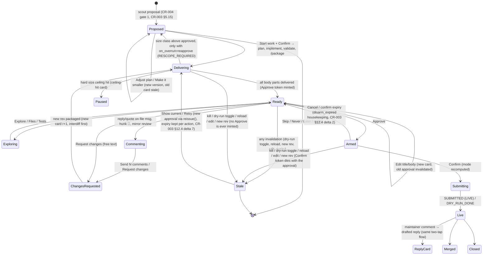

# ADR-0019: PR review surface: native Telegram explorer by default, private GitHub review mirror as the opt-in rich layer
Status: Proposed (CR-003), revision 3 after design review rounds 1 and 2 (`docs/ux/cr003-review.md`) · Date: 2026-10-18 · Design: CR-003 §5, DESIGN §14.3–§14.4a · Related: ADR-0004, ADR-0014, CR-004 · Addendum A (Telegram client library) is the content of the planned ADR-0020

## Context
Amsal reviews almost every candidate on his phone. Today's review surface (DESIGN §14.4) is one card, the verbatim PR body and commit message in `<pre>` parts, a diff paged through `editMessageText`, and a `.patch` file. It is safe, but on a phone it is flat. It has no per-file navigation, no way to comment on a line, and no "what changed since my last review".

Hard constraints that any surface must keep:
- ADR-0004: one bot, polled by the deterministic gatekeeper with long polling (python-telegram-bot 22.8). There is no webhook, no inbound port and no static IP.
- Approve, submit, resume, dry-run off and skill activation stay deterministic gatekeeper actions. Each is two taps (Approve, then Confirm) on single-use, expiring tokens. A token is bound to its message and accepted only from the allowlisted user in the private chat. No LLM is in that path.
- ADR-0014: an approval binds the gatekeeper-derived patch, the head SHA and the title/body hashes. Any edit invalidates it.
- Nothing public happens before approval. Dry-run is on by default and always labelled.

### Research (October 2026; sources in CR-003 §19)
- Bot API 10.1–10.3 added **rich messages**: `sendRichMessage`, `sendRichMessageDraft`, and `editMessageText(rich_message=…)`. A rich message holds up to 32,768 characters and 500 blocks. Blocks include headings, tables, collapsible `details`, expandable quotes, `pre` with a language, in-document anchors and in-body buttons. A message can be built from typed **blocks** with no markup parsing at all.
- Bot API 10.3 added disabled buttons and `force_reply` on inline keyboards. Bot API 9.4 added button styles (`success`, `danger`, `primary`). Bot API 9.3 and 9.4 added topics in private chats. Bot API 9.5 added the `date_time` entity (`<tg-time>`), which the client renders in local time or as relative time.
- A user's reply can carry a `quote` (`TextQuote`: the selected text plus its UTF-16 position). That anchors a comment to the exact lines the user selected.
- Mini Apps can be validated without the bot token, using the Ed25519 `signature` field and Telegram's published public key. They also offer `DeviceStorage` (5 MB per user), `SecureStorage` (Keychain/Keystore, 10 items), Main and Secondary buttons, fullscreen mode and theme parameters. Since 2026-07-20, Mini App methods can't be called from foreign origins.
- **Telegram Serverless** (2026-10-06) hosts JavaScript handlers, endpoints, a SQLite database and Mini App files at `app<id>.tgcloud.ai`. BotFather manages a **webhook** for the bot, and the Bot API refuses `getUpdates` while a webhook is set. Turning Serverless on for the ossbot bot would therefore break ADR-0004.
- python-telegram-bot 22.8 (2026-06-12, still the latest release) fully supports Bot API 10.0. The 10.1–10.3 features need raw calls through `Bot.do_api_request`, which the outbox already uses for every send. Whether to keep PTB at all was re-evaluated against aiogram and pyTelegramBotAPI in Addendum A: PTB stays.
- `Telegram.WebApp.sendData` is "only available for Mini Apps launched via a Keyboard button" (a reply-keyboard `web_app` button). It sends ≤ 4,096 bytes as a `web_app_data` service message and closes the Mini App. Mini Apps opened from an inline button or the menu button can't use it.
- Prior art: `SanNw/opencode-telegram` routes only an authenticated "Bridge" through an HTTPS tunnel and keeps the OpenCode server on loopback. Access is protected by Telegram-signed init data, an owner check and a trusted-device key. HTML previews are static and sandboxed. Even that design adds an internet-reachable component. ossbot does not need one by default.

## Options

**A. Native Telegram.**
- The decorated card stays a classic HTML message (the bound approval surface).
- An explorer message walks the sections. A file-view message shows one file at a time with syntax-highlighted hunks (Prev/Next edit it in place; a file picker jumps): a rich message when available, classic `<pre><code class="language-diff">` pages otherwise.
- Long sections sit in expandable blockquotes or `details` blocks. Test-log excerpts are included.
- Two documents are attached: a full `.patch` and a self-contained, script-free HTML diff.
- To comment, the user replies to a file message, optionally quoting lines, or taps 💬 and picks a hunk. Comments collect into a draft review that is sent as one change request.
- A revised candidate shows a gatekeeper-computed interdiff.

**B. Telegram Mini App diff viewer.** A web app with a split or unified diff, a file tree, logs and inline comments. Approve stays a chat button. It needs a way to get data into the app without a static IP:
- **B1 static app on GitHub Pages with end-to-end encrypted data.** The app code would be public, and GitHub Free serves Pages only from public repositories. The ciphertext has no carrier. A URL fragment holds only a few KB. Telegram files can't be fetched without the bot token. A secret gist needs a new gist-write credential and is readable by URL. In practice B1 does not work for real diffs.
- **B2 Telegram Serverless.** The platform webhook conflicts with long polling, so B2 needs a second bot. It also needs a Node toolchain, a separate CLI token, and a way to move bundles from the gatekeeper into the serverless database: bot-to-bot messages to that second bot. Pre-approval diffs would sit in Telegram's serverless database, in plaintext unless also end-to-end encrypted.
- **B3 optional tunnel to a read-only local review server.** Tailscale Funnel gives a stable `*.ts.net` name, and TLS ends on the device, so Tailscale can't read the content. A Cloudflare named tunnel needs a domain, and TLS ends at Cloudflare. Cloudflare quick tunnels are for testing only and do not support SSE. The server would verify the Ed25519 init-data signature, so it holds no bot token. It would hold no secrets and serve only derived artifacts. **Comments are constrained by `sendData`**: it works only when the Mini App was launched from a reply-keyboard `web_app` button, carries ≤ 4,096 bytes, and closes the app. A review card's inline button or the menu button can't be used for a commenting Mini App, and CR-003 §16 rules out a persistent reply keyboard. So B3 has two possible comment models:
  - **B3-view (chosen if B3 is ever built):** the Mini App is view-only, opened from an inline `web_app` button on the explorer; comments stay native Telegram replies and quotes (option A).
  - **B3-batch:** during a review session the gatekeeper shows a **temporary one-button reply keyboard** (`[🌐 Review in app]`, `one_time_keyboard`), removed with `ReplyKeyboardRemove` when the session ends or after 30 minutes. The user writes comments in the app and submits **one batch** (≤ 4,096 bytes of JSON, about 10–20 short comments), which closes the app and arrives as a `web_app_data` update that the gatekeeper validates like any comment. More comments mean reopening the app.

  The server stays read-only in both models. This is the cleanest B, but it is a new internet-reachable path plus a web front-end to build and maintain.

**C. Private GitHub review mirror.**
- The gatekeeper pushes a display copy of the candidate to a private repo owned by Amsal1 (e.g. `Amsal1/ossbot-review`) and opens a PR there.
- Amsal reviews in the GitHub mobile app, with its diff UI, file tree, inline comments and suggestions.
- The gatekeeper polls the mirror PR and turns his review into a change request. It is a write to GitHub, but not a public one. It uses a separate fine-grained token scoped to that one private repo.

**D. Telegraph article (Instant View)** for the review text (user suggestion, 2026-10-18). This is evaluated and **rejected for review content**:
- Telegraph pages are public to anyone with the URL.
- The API can't delete a page; blanking it is the only option.
- Content is capped at 64 KB.
- Only basic tags are allowed: no syntax highlighting, no tables, no collapsible blocks.

Pre-approval diffs, vetting and maintainer notes, and unreleased changes would become public and permanent before any approval, which violates "nothing public before approval". CR-003 §6.8 allows Telegraph only for opt-in, scanned assistant answers.

**Combinations.** A+C, A+B3 and A+C+B3, evaluated in the second table below. A is the base of every combination because it is the only option that needs no setup and adds no exposure.

### Evaluation

| | A native | B1 Pages + E2E | B2 Serverless | B3 tunnel Mini App | C private mirror |
|---|---|---|---|---|---|
| Phone UX | Good with rich messages (file per message, highlighted hunks, collapsible sections); fair on classic fallback | Excellent if it worked | Excellent | Excellent | Excellent (GitHub mobile diff, tree, expand context, suggestions, rendered Markdown) |
| Inline comments | Yes: reply or quote on file messages, hunk picker | Needs a write path | Yes (endpoint) | Only via a one-shot reply-keyboard button (≤ 4 KB per batch, the app closes); none from inline- or menu-launched apps | Yes, native review comments and suggestions |
| New exposure | None | Public app code; a third-party store for ciphertext | Second bot, JS runtime on Telegram, CLI token | **Internet-reachable server** via tunnel; tunnel daemon and egress | New write token, scoped to one private repo; no inbound |
| Data leaving the laptop, and to whom | Telegram (cloud chats use server-client encryption, like today's cards) | GitHub Pages (app), gist host (ciphertext) | Telegram Serverless DB | Tunnel provider (Funnel: metadata only; Cloudflare: plaintext); Telegram | GitHub (Microsoft), private repo: the touched files at base and head, title/body, commit message, validation summary |
| User setup | None | Pages repo, BotFather URL | BotFather Serverless, second bot, Node | Tailscale/Cloudflare account, BotFather URL | Create a private repo, disable Actions, one fine-grained token |
| Build effort | Medium | High, and blocked on the carrier | High (new stack) | High (web app, server, tunnel provisioning, uid, doctor) | Medium (plumbing trees, push, PR, poll, map comments) |
| Failure modes | Rich rendering differs between client versions (classic fallback); Telegram outage | Carrier limits | Webhook conflict; vendor lock-in; platform is new | Tunnel down, DNS lag, WebView quirks, exposed attack surface | GitHub outage, push protection blocking a test secret, token expiry, repo made public |
| Can it approve? | Only through the chat card (unchanged) | Never | Never | Never | **Never**: GitHub review states are ignored for approval |

#### Combinations (each row states what the combination adds **on top of A**)

| | A+C | A+B3 | A+C+B3 |
|---|---|---|---|
| Phone UX | A for quick reviews, GitHub mobile for deep ones (tree, expand context, suggestions); one tap between them (card row 4) | A plus a web diff viewer inside Telegram; no app switch | Three ways to read the same diff; the extra one adds little over C |
| Inline comments | A's replies and quotes **plus** native GitHub line comments and suggestions, mapped into the same draft review | A's replies and quotes; B3 adds batched comments only through the temporary reply keyboard (≤ 4 KB, app closes), or none in B3-view | C's native comments already cover everything B3-batch could add |
| Marginal exposure | One write token scoped to one private repo; **no inbound path** | **An internet-reachable server** (tunnel), a tunnel daemon and its egress, a Mini App origin | The union: write token **and** an inbound path |
| Marginal data leaving the laptop | Touched files at base and head, PR text and a validation summary to a private GitHub repo | Tunnel provider metadata (Funnel) or plaintext (Cloudflare), plus Telegram WebView caches | The union of both |
| Marginal user setup | Private repo, Actions off, one fine-grained token, `ossctl review-mirror enable` | Tailscale account and Funnel, BotFather Mini App URL | Both |
| Marginal build effort | Medium: plumbing trees, push, PR, poll, comment mapping (CR-003 §14.8 M4) | High: web front-end, read-only server, Ed25519 validation, tunnel provisioning, doctor checks | High + medium |
| Marginal failure modes | GitHub outage, push protection, token expiry, repo made public (P0 check) | Tunnel down, DNS lag, WebView quirks, a new attack surface to patch | Both sets; neither layer can break A |
| Can it approve? | Never | Never | Never |

**Recommended: A+C** (A always on; C opt-in). **A+C+B3 is rejected for now**, because B3 would add the only inbound path in the whole system, and its comment model (one-shot batches through a temporary reply keyboard) gives no comment capability that C's native GitHub review comments lack. A+B3 is rejected because it pays B3's exposure for a viewer that C already provides without any inbound path.

## Decision
1. **A is the default and is always on.** It works with zero extra setup. The approval card and the Confirm step stay classic HTML messages whose reply-markup tokens are bound to the card's message ID (CR-003 U3). Rich messages are used only for read-only views: explorer, files, interdiff, tests and assistant answers. They are built in **blocks mode** with plain strings and `skip_entity_detection`, so no untrusted byte is ever parsed as markup. On a client or API failure the gatekeeper falls back to the existing classic renderer automatically.
2. **C is the opt-in rich layer.** `review_mirror.enabled: false` by default. Enabling it requires the mirror repo, its token, a passing `ossctl review-mirror enable` doctor probe and a human-confirmed `/reload`. When it is on, the card gains a URL button `🐙 Review on GitHub`, and mirror review comments become draft-review comments in Telegram (CR-003 §5.14). C beats B as the rich layer for three reasons: GitHub mobile already is a first-class diff reviewer, C adds no inbound path, and there is no web UI to maintain.
3. **B is deferred to phase 2.** If it is ever built, it is B3 and must stay optional, off by default and read-only. It must verify init data with Ed25519 (no bot token on the server), hold no secrets and never approve. It starts as **B3-view**: opened from an inline `web_app` button, view-only, with comments as native replies (option A), because `sendData` is unavailable to inline- and menu-launched Mini Apps. B3-batch (a temporary one-button reply keyboard, one ≤ 4,096-byte batch per open) is allowed later only with its own review, since it is the one place a reply keyboard would appear. **Serverless is rejected for this bot** while ADR-0004's long polling stands. B1 is rejected because there is no data carrier. **D (Telegraph) is rejected for every kind of review content**, because its pages are public and can't be deleted.
4. **The approval binding is unchanged.** Every display artifact is derived from `derived/<cid>/<rev>/` and is never bound or trusted: rich views, interdiff, HTML diff and the mirror commits. Display artifacts include the mirror commits, whose SHAs differ from the real ones. The binding stays `patch_sha256`, `head_sha` and the title/body hashes (ADR-0014).

## Review flow (states and screens)
Field-level content, keyboards and limits are in CR-003 §5. Mockups are in `docs/ux/`.

| Screen | State | What the user sees | Mockup |
|---|---|---|---|
| S0 Proposal (gate 1) | Proposed | Proposal card: problem, approach, likely files, size estimate (code/test), validation plan, signals, confidence; Start work (two taps), Adjust plan, Make it smaller, Skip, Never, Later; versions reply to each other with a deterministic diff | `10-proposal-card.svg` |
| S1 Preview card | Delivering → Ready | Header with mode badge, subject, verified checks, model claims marked 🤖, change stats, size estimate vs actual (code/test split, overrun highlighted, never blocked by default), expiry as relative `tg-time`; body and commit message parts below; keyboard minted only after delivery | `01-pr-preview-card.svg` |
| S2 Explorer | Exploring | One message, sent as a reply to the card and edited in place: 1 Summary → 2 Why this issue → 3 Signals → 4 Risk → 5 Files → 6 Diff → 7 Tests → 8 Self-review → 9 PR text | `02-diff-explorer.svg` |
| S3 File view | Exploring | One file-view message per rev, edited in place: hunks highlighted as `diff`; collapsible long hunks; ◀ Prev file · 📂 picker · Next file ▶; 💬 Comment; `.patch`/HTML documents | `02-diff-explorer.svg` |
| S4 Draft review | Commenting | Each comment acknowledged (file:line, Undo); one draft-review message: "📝 3 comments · Send · Discard" | `02-diff-explorer.svg` |
| S5 Changes in progress | ChangesRequested | Old card stubbed "✏️ Changes requested → r3 in progress"; stage progress edited in place | `04-interdiff.svg` |
| S6 Revised card | Delivering/Ready (r+1) | New card, sent as a reply to the old one: what you asked for → interdiff (gatekeeper) → "coder says" per comment (🤖) → "touched in interdiff" flag per comment (gatekeeper) | `04-interdiff.svg` |
| S7 Edit text | Ready | Picker: Title / Body / Body as file / Clear my edits; ForceReply; new card, old one stale | `01-pr-preview-card.svg` (notes) |
| S8 Confirm | Armed | Card edited to the Confirm panel: 🧪 DRY RUN or 🔴 LIVE banner, exact Confirm sentence, review coverage, unsent-comment warning, 5-minute relative expiry | `03-approve-confirm.svg` |
| S9 Submitting | Submitting | Progress lines: fork, push, PR | `05-submitted-status.svg` |
| S10 Live status | Live | A status card edited in place (CI, reviews, maintainer comments); P1 events arrive as replies; drafted replies use S1/S8 | `05-submitted-status.svg` |
| S11 Merged/closed | Merged/Closed | Status card finalized; summary message (with a message effect when configured) | `05-submitted-status.svg` |
| S12 Stale | Stale | Card header "⚪ Superseded/Expired/Invalidated: <label>" (label from the real reason code, CR-003 §5.12), disabled button "⛔ Not approvable", "⬇️ Show current" or "🔁 Retry" (a fresh card via `reissue()`) | `04-interdiff.svg` |

Queue and priority (CR-003 §5.13): pending approvals sort by `(class_rank, expires_at, -target_priority, created_at)`. Classes, highest first:
0. Someone is waiting: a reply to a maintainer, or a `push_update` a maintainer asked for.
1. `issue_claim`, and every `👤` user-directed proposal or preview.
2. Other `push_update`, and ceiling-hit cards.
3. `open_pr` previews, `RESCOPE_REQUIRED` cards and skill cards.
4. Autonomous proposals (gate 1), ordered by CR-004's rank score; promoted to class 2 within 6 h of expiry.
5. Other comments.

At most `telegram.loud_cards_per_hour` (default 2) new cards notify with sound; the rest are sent silently and counted on the dashboard. `/queue` (mockup `12-queue.svg`) lists Gate 2 items, then Gate 1 items, with numbered Open buttons. Opening an item re-sends its card with the expiry kept, so the item keeps its place in the list.

## Option C, normative details
- **Repo:** `profile.yaml review_mirror.repo` (e.g. `Amsal1/ossbot-review`). The user creates it, with a README on `main`.
  - Before every push, and every 10 minutes while it is enabled, the gatekeeper checks `GET /repos/<mirror>`: `private == true` and `visibility == "private"`. It also checks `GET /repos/<mirror>/actions/permissions`: `enabled == false`.
  - Either check failing disables the mirror and raises an alert. A repo that is public is a P0 alert.
  - Actions must be off because the mirrored tree contains upstream workflow files, and a PR would run them.
- **Token:** `GITHUB_REVIEW_MIRROR_TOKEN` in `gatekeeper.env` (0600 gatekeeper).
  - Fine-grained, resource owner Amsal1, "Only select repositories" = the mirror.
  - Permissions: Contents RW, Pull requests RW, Metadata R, and Administration R (only to read the Actions setting; **[VERIFY]** the minimum permission).
  - GitHub documents that only classic tokens can write to public repositories the user does not own, and the repository selection excludes his own public forks.
  - The existing classic `public_repo` token cannot reach private repos, so the two tokens can't be swapped by accident.
- **Probe at enable time** (`ossctl review-mirror enable`, human-initiated only, never during automated builds):
  - `GET /user` must return `login == profile.github_login`.
  - A foreign-write probe on one of Amsal1's public repos: `POST /repos/<public repo>/git/refs` with an all-zero SHA and a random `refs/heads/ossbot-probe-*` name. It cannot create anything. 403 or 404 passes. 422 means the token can write there, so enable is refused and a P0 alert says to revoke the token.
  - `GET /repos/<mirror>` with the classic write token must return 404.
  - The token's `github-authentication-token-expiration` header is recorded. A P1 reminder goes out 14 days before expiry.
- **Sparse snapshot commits (display only):**
  - Built in the per-rev bare mirror with the hardened `GIT_ENV`/`GIT_ARGS` and a temporary `GIT_INDEX_FILE` under `/srv/ossbot/gatekeeper/work/`, using plumbing only (`read-tree --empty`, `ls-tree -z`, `update-index --cacheinfo|--force-remove`, `hash-object -w --stdin`, `write-tree`, `commit-tree`).
  - `B'` holds the base versions of exactly the touched paths. It is a root commit (`commit-tree <tree>` with no parent).
  - `H'` holds the head versions, plus `.ossbot-review/{PR_BODY.md,COMMIT_MSG.txt,REVIEW.md}` built by the gatekeeper. It is committed **with `B'` as its parent** (`commit-tree <tree> -p <B'>`), so the two branches share history and GitHub can open a PR between them (without a common ancestor GitHub refuses the PR).
  - A new rev builds a fresh `B'`/`H'` pair; the force-push replaces both branches, so GitHub's "force-pushed" compare link stays meaningful.
  - Commit messages and PR text never contain `@`, `#N` or bare URLs: upstream links appear only inside code spans, so no cross-references or notifications are created.
  - Fixed identity: `ossbot review mirror <noreply@invalid>`, with the package timestamp as the date.
  - **Integrity check before push:** `diff --raw B' H'` outside `.ossbot-review/` must equal `diff --raw <base> <head>` (paths, modes, blob IDs). A mismatch means no push and an ERROR log. A candidate that touches `.ossbot-review/` is refused for mirroring.
  - Pushes are small: only the touched files.
- **Push and PR:**
  - `review_mirror_writer.py` is the only module allowed to write. It is importable only by `review_mirror.py`, enforced by an import-linter contract. It hard-refuses any URL or API path outside `/repos/<mirror>/` and `https://github.com/<mirror>.git`.
  - It force-pushes `H':refs/heads/review/<cid>` and `B':refs/heads/review-base/<cid>`. Force is allowed **only** here; the main writer still never force-pushes.
  - It opens or updates the PR: head `review/<cid>`, base `review-base/<cid>`, title `[<cid> r<rev>] <title>`, and a body with the card facts and instructions.
  - A new rev force-pushes over the old one. GitHub then shows "force-pushed" with a compare link, which is a second interdiff for free.
- **Reading back:**
  - Polling: every 60 s while the approval is pending, every 10 min otherwise, with ETags. It reads `pulls/<n>/reviews`, `pulls/<n>/comments` and `issues/<n>/comments`.
  - Only comments by `profile.github_login` count. Each comment's `path` must be in this rev's numstat. A comment whose `commit_id` is not the current `H'` is flagged outdated.
  - A submitted review (Comment or Request changes) becomes **one** change request with all its comments and suggestions, verbatim. A Telegram note goes out ("🐙 GitHub review: 3 comments → change request r3").
  - Single comments outside a review join the Telegram draft review.
  - An **Approve** review is ignored for approval. Telegram replies: "Approvals only count here", with `⬇️ Show card`.
  - A commit the user makes on the mirror branch, such as "edit file" in GitHub mobile, becomes a change request carrying its compare patch as guidance. It is never pushed upstream. The next rev overwrites it.
- **Retention:**
  - When the approval is consumed, rejected or terminal, the gatekeeper closes the mirror PR and deletes both branches.
  - GitHub keeps `refs/pull/<n>/head` in the private repo, so `ossctl review-mirror purge` documents deleting and recreating the repo.
  - Backups never include mirror state.

## Option A, normative summary
- **Card:** classic HTML, ≤ 3,900 escaped characters, with the existing two-phase keyboard. The keyboard is regrouped per action kind (CR-003 §12.4.1):
  - `open_pr`:
    - Row 1: Approve, Reject.
    - Row 2: Explore, Files. On revised cards, Interdiff replaces Files.
    - Row 3: Request changes, Edit text.
    - Row 4: mirror URL, only when enabled. When the mirror push lands after the card was sent, row 4 is added with `editMessageReplyMarkup` re-using the **same** callback tokens already on the card (nothing is minted or rotated). An armed card gets it when it returns to S1.
  - `push_update`: Approve & Push, Reject fix / Explore, Files / Request changes.
  - `comment` and `issue_claim`: Approve & Post, Reject / Edit text. Edit text opens the comment edit prompt directly. There is no explorer, because the verbatim body is the whole content.
  - Decision buttons are single-use. View buttons (Explore, Files, Interdiff, Edit text) are **multi-use** until the approval ends, so they work however often they are tapped.
  - Tests and logs move into the explorer.
  - Approve exists only on the card, never in explorer or file views.
- **Explorer and file messages** (only for `open_pr` and `push_update`):
  - They are sent as replies to the card, so tapping the quote header jumps back.
  - There is one file-view message per `(cid, rev)`. Prev/Next edit it in place, and a file picker jumps between files.
  - Their tokens are multi-use navigation tokens (24 h, message-bound) with `approval_id = NULL` and `{cid, rev, action_id}` in their argument. They resolve the current approval of **their own outbound action**, which stays unambiguous when a claim or a drafted comment is open beside the PR. So a Cancel or a re-sent card never kills them (CR-003 §12.2, §12.4).
  - After Confirm, they stay usable read-only.
  - Model-authored text is always labelled 🤖 and quoted. Gatekeeper-verified facts carry ✅ and no label.
- **Re-sending a card** (Show card, Show current, `/queue → Open`, `/approve`) uses `reissue()` and keeps each approval's expiry. It re-sends every open card of the contribution (CR-003 §5.2, §12.4 deltas 5 and 7).
- **Comments:**
  - A reply to a file message becomes a comment on that file.
  - A `quote` resolves to lines by searching the quoted text in that page's diff text. Ties are broken by `position`. An ambiguous match opens a line picker. No match anchors the comment to the file only.
  - The hunk picker works in both rendering modes.
  - Comments are stored in `review_comments` and sent together, with optional free text, as one `change_requests` row whose `comments_json` holds the structure.
- **Interdiff:**
  - Computed at `/package` of rev N against rev N−1, using the fixed commands `ossbot.common.gitcmd.INTERDIFF` (tree diff, same base) and `RANGE_DIFF` (base moved).
  - In base-moved mode, `range-diff` output is not a patch: the file list comes from comparing the normalized per-file hunks of the two derived `FORMAT_PATCH` outputs, "touched" is file-level only, and the interdiff view is a plain `pre` with file-level comments (CR-003 §5.7).
  - The rev N mirror gets a temporary `objects/info/alternates` entry for the rev N−1 mirror. To keep that mirror available, DESIGN §12.5 retention changes: the newest **shown** rev's mirror is kept until the next `/package` or a terminal state, not deleted at `IMPLEMENTING`.
  - The interdiff is display-only. The card says "you approve the full patch".
- **Documents:**
  - `.patch` is the existing derived patch.
  - `ossbot-review-<cid>-r<rev>.html` is rendered with Jinja2 autoescape from derived data only. It has inline CSS and no script. Its CSP is `default-src 'none'; style-src 'unsafe-inline'; img-src data:`. It works in iOS Quick Look, Android Chrome or Files, and desktop browsers. **[VERIFY]** how Telegram opens it on Amsal's phone.

## Consequences
- **Good:** the default needs no setup and no new exposure. Phone review gets per-file navigation, line comments, interdiffs and test evidence. The approval code path keeps its rules (token format and checks, binding, Confirm sentences); the UI needs nine bounded deltas, each tested, listed in CR-003 §12.4. The richest layer (C) reuses GitHub's mature mobile reviewer, with no inbound path and a token that cannot write anywhere else.
- **Costs:**
  - Raw Bot API calls for 10.1–10.3 features, behind a typed adapter (`telegram/rawapi.py`, pydantic models), until PTB v23 ships typed support. This was chosen over switching libraries (Addendum A): it keeps lenient decoding on the safety-critical polling path and costs no migration.
  - Two renderers (rich and classic) with property tests.
  - Interdiff needs the previous mirror kept a little longer.
  - C adds a second GitHub credential to rotate.
  - C adds GitHub (Microsoft) as a holder of pre-approval content for touched files, in a private repo. Telegram already holds the same content today.
- **Risks:**
  - Rich messages are new and render differently across client versions. The automatic fallback and the live check in CR-003 §17 cover this.
  - If the user flips the mirror repo to public, pre-approval content becomes public. The visibility check runs before every push and every 10 minutes and raises a P0 alert, but content already pushed is exposed. Rotation is documented.

## Verification items
1. Rich-message rendering, quote-replies on rich messages, and `details` and `diff` highlighting on Amsal's Telegram clients (phone and desktop).
2. How each client opens `.html` documents.
3. The minimum fine-grained permission needed to read `actions/permissions`.
4. The foreign-write probe's status codes for a fine-grained token.
5. Whether GitHub creates any cross-reference from code-span URLs (expected: none).
6. The Serverless webhook behaviour, recorded only if B2 is ever reconsidered.
7. End-to-end: `stopped_message_generation` arrives through PTB 22.8 in `api_kwargs` and is accepted in `allowed_updates` (the PTB side is verified from source, Addendum A).

## Addendum A: Telegram client library (content of the planned ADR-0020)
Status: Proposed · Date: 2026-10-18 · Facts verified on the web on 2026-10-18 (sources in A.6) · Related: ADR-0004, CR-003 §1, §6.5, §14.1, §14.4

### A.1 Context
The gatekeeper is the only Telegram poller (ADR-0004). One `getUpdates` stream carries Approve, Confirm, `/kill`, `/pause` and every assistant message. The code today is built on python-telegram-bot 22.8: `telegram/bot.py` (`TelegramSender`, `PollTrackingRequest`, `build_application`), `handlers.py` (PTB `CallbackQueryHandler`/`MessageHandler`), `auth.py` (PTB `Update`), and the fake-Bot-API tests in `tests/telegram` (an injected `BaseRequest`). CR-003 uses Bot API 10.1–10.3 features (rich messages and rich drafts, `can_stop`, `stopped_message_generation`, `DisabledButton`, `force_reply` on inline keyboards, `RichTextButton` in incoming rich messages) plus 9.3/9.4 private-chat topics. The earlier "no new runtime dependency" constraint has been lifted by the user, so the library is chosen on its merits; a swap is acceptable if the code is refactored cleanly.

### A.2 Candidates (current facts)

| | python-telegram-bot | aiogram 3.x | pyTelegramBotAPI (telebot) |
|---|---|---|---|
| Latest release | 22.8 (2026-06-12) | 3.31.0 (2026-08-26) | 4.37.1 (2026-10-17) |
| Bot API level | 10.0. Issue #5261 "Full Support for Bot API 10.1" is open; on 2026-06-18 the maintainers paused it "until we complete major refactors" (tracked for v23); community PRs #5263, #5275, #5356, #5359 are pending | 10.3 (3.29.0 = 10.1 on 2026-06-14, 3.30.0 = 10.2 on 2026-07-17, 3.31.0 = 10.3 on 2026-08-25) | 10.3 (4.35.0 = 10.1 on 2026-07-12, 4.36.0 = 10.2 on 2026-07-18, 4.37.0 = 10.3 on 2026-09-21) |
| Adoption speed of new Bot API versions | Slow now (10.1 still missing after 4 months) | Fastest: 1–3 days | 3–4 weeks |
| Unknown or new fields in updates | **Lenient.** `TelegramObject._de_json` moves keys that are not constructor parameters into `api_kwargs` instead of raising (v22.8 source); unknown `Update` keys such as `stopped_message_generation` survive there | **Strict.** Models are pydantic with `extra="allow"`, so unknown *fields* pass, but a new **union member** or a missing required field fails validation of the whole `Response[list[Update]]`. #1890: the 10.3 `RichTextButton` raised `ClientDecodeError` and "the polling offset never advances", blocking the bot until the upgrade to 3.31. #1840 (a `MessageOriginHiddenUser` without `sender_user_name` blocks polling) is open, and the generic fix PR #1848 (skip invalid updates) is unmerged | Lenient: `de_json` reads known keys with `obj.get(...)` and ignores the rest (unknown keys are dropped, not kept) |
| Typed coverage of what CR-003 uses | Topics, `style`, reactions, scopes, pins, `copy_text`, drafts without `can_stop`: yes. Rich messages, `can_stop`/`keep_on_stop`, `stopped_message_generation`, `DisabledButton`, `force_reply` on inline keyboards, `RichTextButton`: no (raw) | All of them, including ephemeral messages and guest mode | All of them at 10.3 (e.g. `Update.stopped_message_generation` → `MessageGenerationStopped`) |
| asyncio beside FastAPI over UDS | Native asyncio `Application`; we already run it next to FastAPI | Native asyncio; good fit | `AsyncTeleBot` exists (aiohttp); the sync `TeleBot` is the primary API |
| Maintenance and bus factor | Team project; top contributors Bibo-Joshi (532 commits), leandrotoledo (526), jh0ker (486), tsnoam, jsmnbom; dependency and security updates landing weekly (Oct 2026) | One dominant maintainer: JrooTJunior 1,662 commits vs 91 for the next | Two active maintainers: Badiboy (1,027), coder2020official (892) |
| Licence (open-source-later goal) | LGPL-3.0-only: fine as an unmodified dependency of a project under any licence | MIT | **GPL-2.0**: distributing ossbot with it ties ossbot to GPL-2.0-compatible terms (not Apache-2.0, not GPL-3.0-only) |
| Test and mocking support | Injected `BaseRequest`, which `tests/telegram` already uses | Custom `BaseSession` or aiohttp mocking; tests to rewrite | Monkeypatching `apihelper`; tests to rewrite |
| Migration cost from `src/ossbot/gatekeeper/telegram/` | **None** | High: `bot.py`, `handlers.py`, `auth.py`, the poll-health tracking and every Telegram test rewritten against aiogram's dispatcher/router model | High: the same, against a less typed API |

### A.3 Options
1. **Keep PTB 22.8 and add a thin typed adapter** (`telegram/rawapi.py` + `telegram/ui/blocks.py`): pydantic request models (`extra="forbid"`) for every 10.1–10.3 method and field we send, and response models with `extra="ignore"` for the few results we read; called through `Bot.do_api_request` as the outbox already does. Incoming 10.x shapes (`stopped_message_generation`) are read from `api_kwargs` with a pydantic model.
2. **Switch to aiogram 3.31.** Full typed 10.3 today and the fastest adoption, MIT. But its strict decoding has already blocked long polling twice in 2026 (#1890 fixed by an upgrade, #1840 still open), and ossbot pins exact versions, so every future Bot API union addition could stop Approve, Confirm and `/kill` until a rebuild. Bus factor 1.
3. **Switch to pyTelegramBotAPI 4.37.** Typed 10.3 and tolerant decoding, but GPL-2.0 constrains the open-source-later licence, the async API is secondary, and the migration cost is as high as aiogram's.
4. **Own minimal client** (httpx + our pydantic models, our own poll loop). Maximum control and tolerance by design, but it rewrites the transport, retry, rate-limit and poll-health code that PTB already provides and that Phase 1 reviewed. The adapter in option 1 gives the same typing for the new features without that.

### A.4 Decision
**Option 1: keep python-telegram-bot 22.8, with the typed adapter.**
- Lenient decoding is the property that matters most for a long-polling safety bot: one unknown field must never stop the update stream that carries `/kill`. PTB has it; aiogram has shown in production that it lacks it.
- Zero migration cost, and the Phase 1-reviewed transport, auth and tests stay as they are.
- LGPL-3.0 as an unmodified dependency keeps every licence option open for ossbot.
- The adapter is small and bounded: the 10.1–10.3 surface CR-003 uses is about a dozen methods and fields. When PTB v23 ships typed 10.1+ support, the adapter's call sites switch to typed methods behind the same kit API, as a separate reviewed change.
- Revisit triggers: PTB v23 released (switch the adapter to typed calls); PTB still without 10.1 support by 2027-04 **and** aiogram merging tolerant `getUpdates` (#1848 or equivalent) — then re-run this evaluation.

### A.5 Pillow
**Not added to the gatekeeper.**
- The only needs are metadata stripping and resizing for vision input. Resizing is unnecessary: Telegram already supplies re-encoded JPEG `PhotoSize` variants, and the gatekeeper picks the largest ≤ 1,600 px. Image *documents* are capped at 5 MB, so they need no resizing either.
- Metadata stripping does not need pixel decoding. A pure-Python container walker (JPEG markers, PNG chunks, WebP RIFF chunks) removes EXIF/XMP/text chunks without decoding pixels, so no image decoder (Pillow 13.0.0 is current; image decoders have a long CVE history) runs in the TCB that holds the approval keys. It is fuzzed with Hypothesis (CR-003 §6.5).
- HEIC needs a Pillow plugin anyway; it is rejected with "send it as a photo".
- Image tools that do need decoding (OCR, background removal; phase 2) run in a `--network none` sandbox job, whose image may include Pillow.

### A.6 Sources (accessed 2026-10-18)
- PyPI JSON for python-telegram-bot, aiogram, pyTelegramBotAPI and Pillow (versions, upload dates, licence classifiers): https://pypi.org/project/python-telegram-bot/ , https://pypi.org/project/aiogram/ , https://pypi.org/project/pyTelegramBotAPI/ , https://pypi.org/project/Pillow/
- PTB #5261 and its comments (pause on 2026-06-18; pending PRs): https://github.com/python-telegram-bot/python-telegram-bot/issues/5261
- PTB v22.8 source, `TelegramObject._de_json` and `Update.de_json`: https://github.com/python-telegram-bot/python-telegram-bot/blob/v22.8/src/telegram/_telegramobject.py , https://github.com/python-telegram-bot/python-telegram-bot/blob/v22.8/src/telegram/_update.py
- PTB releases: https://github.com/python-telegram-bot/python-telegram-bot/releases
- aiogram releases (Bot API levels per version): https://github.com/aiogram/aiogram/releases ; base model config (`extra="allow"`): https://github.com/aiogram/aiogram/blob/v3.31.0/aiogram/types/base.py
- aiogram #1890, #1840, PR #1848: https://github.com/aiogram/aiogram/issues/1890 , https://github.com/aiogram/aiogram/issues/1840 , https://github.com/aiogram/aiogram/pull/1848
- pyTelegramBotAPI releases and `types.py` (`Update.de_json` with `stopped_message_generation`): https://github.com/eternnoir/pyTelegramBotAPI/releases , https://github.com/eternnoir/pyTelegramBotAPI/blob/master/telebot/types.py
- Contributor counts: the GitHub contributors API for each repository
- Bot API changelog (10.3 on 2026-08-24 is the latest; `RichTextButton`, `DisabledButton`, `force_reply`, `can_stop`, `MessageGenerationStopped`): https://core.telegram.org/bots/api-changelog
- Mini Apps `sendData`: https://core.telegram.org/bots/webapps

## Responses to design review round 1
- **Finding 9 (combinations not evaluated):** addressed. The combinations table above covers A+C, A+B3 and A+C+B3 on every row with marginal exposure and effort, and states "Recommended: A+C" and why A+C+B3 is rejected.
- **Finding 10 (`sendData`):** addressed. The constraint is stated in Research and in B3; B3 starts view-only (B3-view), B3-batch uses a temporary one-button reply keyboard with one ≤ 4 KB batch per open; the evaluation cell and Decision 3 are corrected.
- **Finding 13 (library evaluation, user-required):** addressed as Addendum A with web-verified facts, URLs and the access date. It is written here because this revision step may edit only CR-003, this ADR and `docs/ux/`; it moves verbatim to `docs/adr/0020-telegram-library.md` in the next docs commit that may create ADR files.
- **Finding 22 (mirror graph, late URL row):** addressed in Option C (`H'` parent `B'`) and Option A (row 4 via `editMessageReplyMarkup` with the same tokens).
- **Finding 1 (token core) and finding 3 (base-moved interdiff):** reflected in the state diagram (confirm-expiry disarm), Option A (kit tokens with `approval_id NULL`) and the interdiff summary; the normative text is CR-003 §12.4 and §5.7.
- **CR-004 (orchestrator-relayed user requirement):** the review flow now starts at the proposal card (S0), and the queue classes and size behaviour follow CR-004 Amendment B (overrun highlighted, not blocked; `RESCOPE_REQUIRED` only with `reapprove`; ceiling-hit card).

## Responses to design review round 2
The normative fixes are in CR-003 (§21 maps each of the 22 findings). This ADR changes where the decision text depends on them:
- **Finding 20 (state diagram):** addressed. The diagram adds `Armed --> Stale` and `Delivering --> Stale`, with their causes (kill, dry-run toggle, reload, edit, new rev). It also adds `Stale --> Delivering` for a re-sent card, which keeps its expiry.
- **Findings 1 and 2 (card buttons, several open actions):** reflected in Option A. Keyboards are per action kind, view buttons are multi-use, the explorer exists only for patch-carrying kinds, and view tokens resolve their own outbound action (`action_id`).
- **Finding 3 (re-sends reset the TTL):** reflected in Option A and the queue paragraph. Re-sends keep the expiry, so `/queue` order is stable (CR-003 §12.4 delta 7).
- **Finding 22 (queue mockup):** the queue paragraph points to the new `docs/ux/12-queue.svg`.
- **Findings 4–19 and 21:** none of them changes this ADR's decision (A by default, C opt-in, B deferred, Serverless and Telegraph rejected for review content). Their fixes are CR-003-only.
